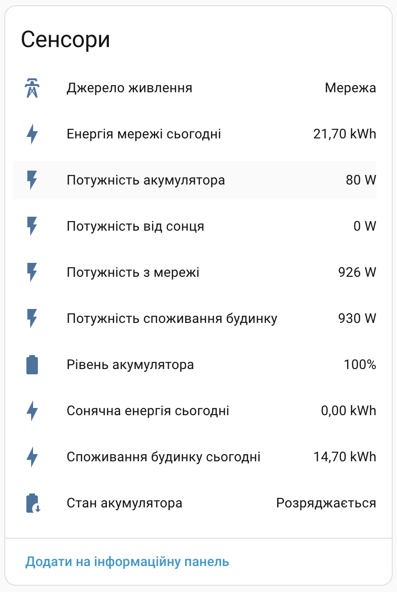
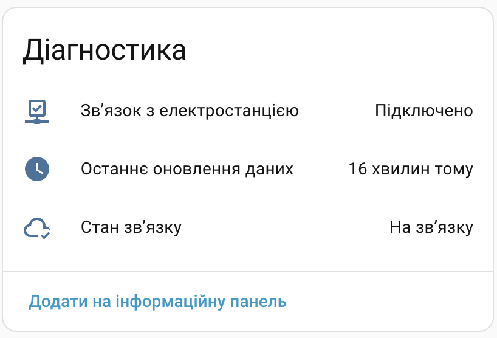

  
  

# ☀️ Файна СЕС для Home Assistant

[![GitHub Release][gh-release-image]][gh-release-url]
[![GitHub Downloads][gh-downloads-image]][gh-downloads-url]
[![hacs][hacs-image]][hacs-url]
[![GitHub Sponsors][gh-sponsors-image]][gh-sponsors-url]
[![Buy Me A Coffee][buymeacoffee-image]][buymeacoffee-url]
[![Twitter][twitter-image]][twitter-url]

[**Українською**](./readme.md) | [English](./readme.en.md)

Моніторинг електростанцій [Файна СЕС][fayna-ses] у [Home Assistant][home-assistant]: акумулятор, потужність, добове споживання та стан зв’язку. Для підключення потрібне публічне посилання на станцію. Обліковий запис не потрібен.

## Спонсорство

Ваша підтримка допоможе мені розвивати й підтримувати більше таких проєктів.

- 💖 [Стати спонсором на GitHub][gh-sponsors-url]
- ☕️ [Підтримати на Buy Me A Coffee][buymeacoffee-url]
- Bitcoin: `bc1q7lfx6de8jrqt8mcds974l6nrsguhd6u30c6sg8`
- Ethereum: `0x6aF39C917359897ae6969Ad682C14110afe1a0a1`

## Встановлення

Потрібен Home Assistant **2026.2.3+**. Іконки інтеграції доступні з **2026.3**.

Додайте користувацький репозиторій у HACS, установіть інтеграцію та перезапустіть Home Assistant.

[![Додати до HACS][hacs-install-image]][hacs-install-url]

Додати репозиторій у HACS вручну

1. Відкрийте **HACS → ⋮ → Користувацькі репозиторії**.
2. Вставте `https://github.com/denysdovhan/ha-fayna-ses`, виберіть тип **Інтеграція**.
3. Завантажте **Fayna SES** та перезапустіть Home Assistant.

Встановити без HACS

1. Скопіюйте `custom_components/fayna_ses` із цього репозиторію в `config/custom_components` вашого Home Assistant.
2. Перезапустіть Home Assistant.

## Використання

Натисніть кнопку та вставте публічне посилання на станцію: `https://fayna-ses.funs.net.ua/s/…`.

[![Додати Файна СЕС][install-image]][install-url]

Додати інтеграцію вручну

1. Відкрийте **Налаштування → Пристрої та служби → Додати інтеграцію**.
2. Знайдіть **Fayna SES** і вставте посилання на станцію.

Для кожної станції створюється окремий пристрій. Щоб додати іншу станцію, повторіть налаштування.

### Сенсори

| Сенсори                          | Діагностика                              |
| -------------------------------- | ---------------------------------------- |
|  |  |

| Дані                                                      | Значення                                       |
| --------------------------------------------------------- | ---------------------------------------------- |
| Рівень і стан акумулятора                                 | %; заряджається, розряджається або очікує      |
| Потужність мережі                                         | Вт; плюс — імпорт, мінус — експорт             |
| Потужність акумулятора                                    | Вт; плюс — розряд, мінус — заряд               |
| Сонячна потужність і споживання будинку                   | Вт                                             |
| Сонячна енергія, енергія мережі та споживання за сьогодні | кВт·год                                        |
| Джерело живлення                                          | Сонце, мережа, акумулятор або без навантаження |

У розділі **Діагностика**: зв’язок зі станцією, детальний стан зв’язку та час останнього оновлення. Потужність обладнання, ємність акумулятора й опис станції — атрибути стану зв’язку.

### Оновлення даних

- Опитування — щохвилини. Вимірювання старші за 30 хвилин стають недоступними; відсутні значення залишаються невідомими.
- Зв’язок зі станцією не означає наявність міського живлення. Джерело живлення — оцінка за потужністю, а не датчик відключень.
- Добові значення скидаються опівночі за Києвом. Облік імпорту й експорту в енергії мережі не задокументований.
- Інтеграція лише читає дані. Керування обладнанням та завантаження історії не підтримуються.

### Видалення

Відкрийте **Налаштування → Пристрої та служби → Fayna SES** і видаліть запис станції через його меню. Після видалення всіх станцій можна видалити інтеграцію в HACS або папку `config/custom_components/fayna_ses`.

## Розробка

Інструкції запуску й перевірок — у [contributing.md](./contributing.md).

## Інші інтеграції

- 💥 [Aerial Danger](https://github.com/denysdovhan/ha-aerial-danger) — повідомлення про повітряні загрози.
- ☁️ [Check Weather](https://github.com/denysdovhan/ha-check-weather) — перевірка погодних умов у прогнозі.
- 💨 [ЛУН Місто Air](https://github.com/denysdovhan/ha-lun-misto-air) — якість повітря.
- 🌦️ [УкрГМЦ](https://github.com/denysdovhan/ha-ukr-hmc) — погода, радіація та гідрологія.
- ⚡️ [Yasno](https://github.com/denysdovhan/ha-yasno-outages) — графіки відключень електроенергії.

## Ліцензія

MIT © [Денис Довгань][denysdovhan]

<!-- Badges -->

[gh-release-url]: https://github.com/denysdovhan/ha-fayna-ses/releases/latest
[gh-release-image]: https://img.shields.io/github/v/release/denysdovhan/ha-fayna-ses?style=flat-square
[gh-downloads-url]: https://github.com/denysdovhan/ha-fayna-ses/releases
[gh-downloads-image]: https://img.shields.io/github/downloads/denysdovhan/ha-fayna-ses/total?style=flat-square
[hacs-url]: https://github.com/hacs/integration
[hacs-image]: https://img.shields.io/badge/hacs-custom-orange.svg?style=flat-square
[gh-sponsors-url]: https://github.com/sponsors/denysdovhan
[gh-sponsors-image]: https://img.shields.io/github/sponsors/denysdovhan?style=flat-square
[buymeacoffee-url]: https://buymeacoffee.com/denysdovhan
[buymeacoffee-image]: https://img.shields.io/badge/support-buymeacoffee-222222.svg?style=flat-square
[twitter-url]: https://x.com/denysdovhan
[twitter-image]: https://img.shields.io/badge/follow-%40denysdovhan-000000.svg?style=flat-square

<!-- References -->

[home-assistant]: https://www.home-assistant.io/
[denysdovhan]: https://github.com/denysdovhan
[hacs-install-url]: https://my.home-assistant.io/redirect/hacs_repository/?owner=denysdovhan&repository=ha-fayna-ses&category=integration
[hacs-install-image]: https://my.home-assistant.io/badges/hacs_repository.svg
[install-image]: https://my.home-assistant.io/badges/config_flow_start.svg
[install-url]: https://my.home-assistant.io/redirect/config_flow_start/?domain=fayna_ses
[fayna-ses]: https://fayna-ses.funs.net.ua/
